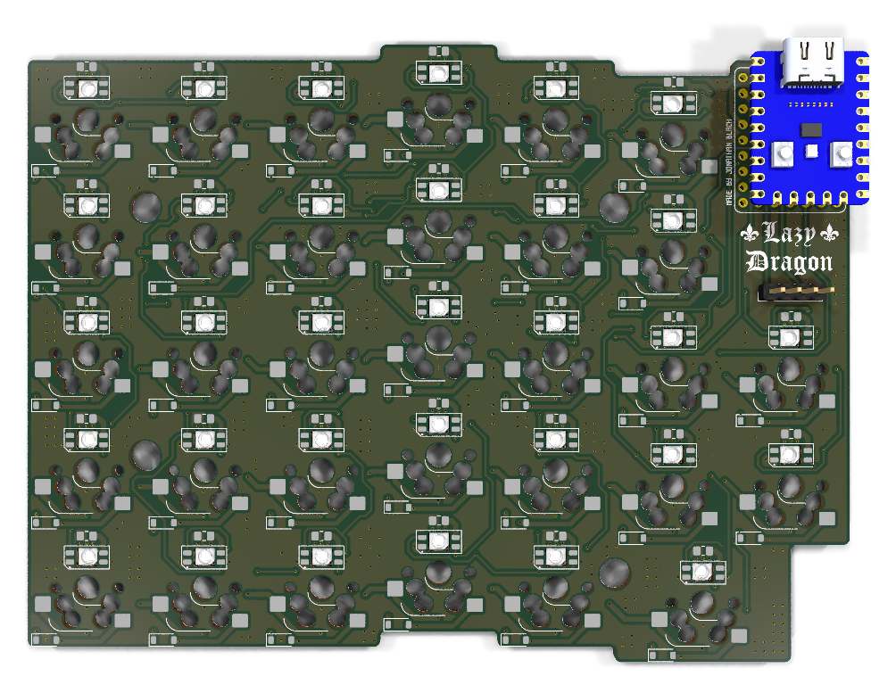
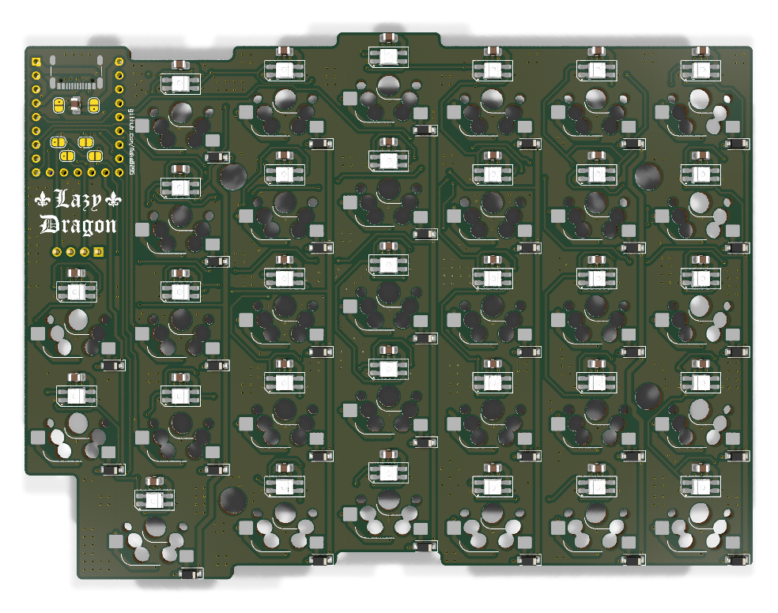
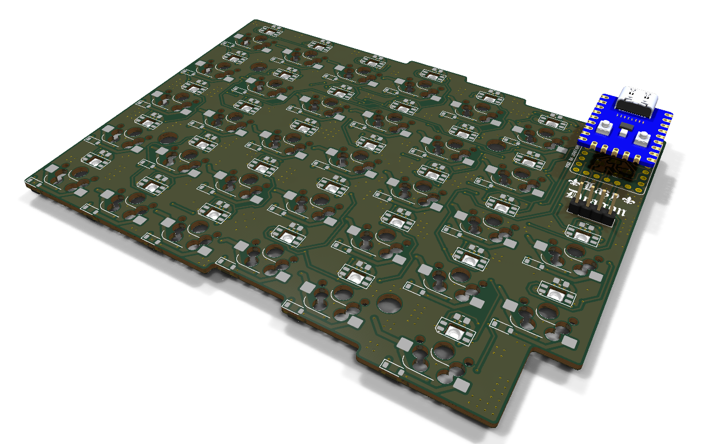
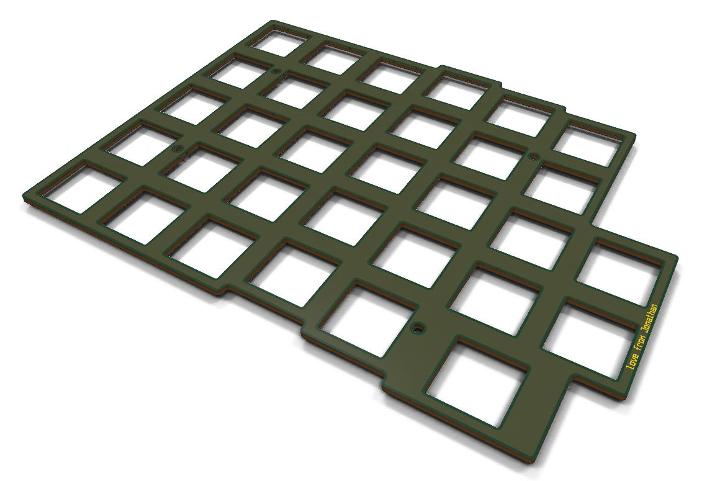
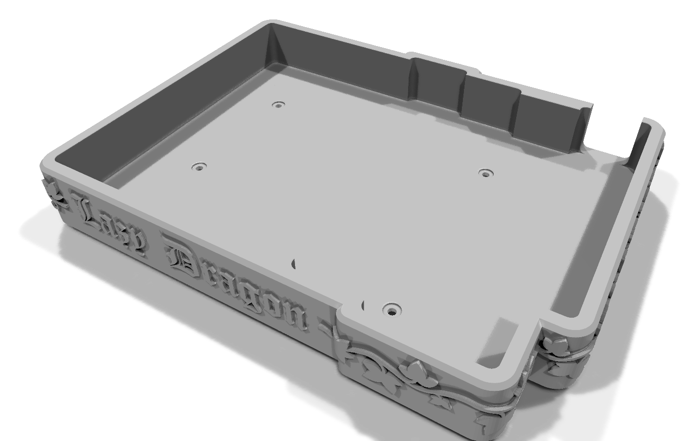
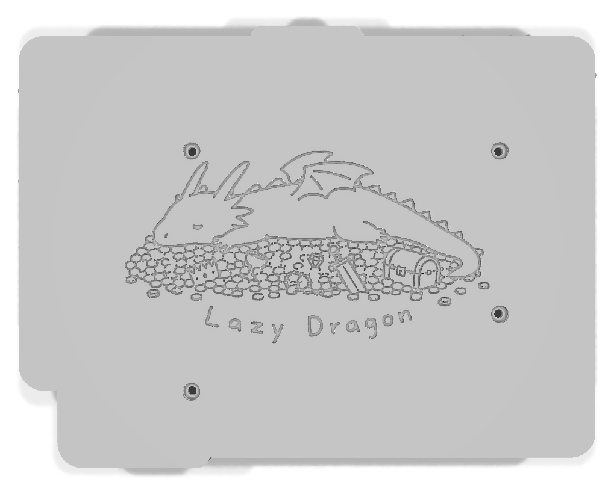
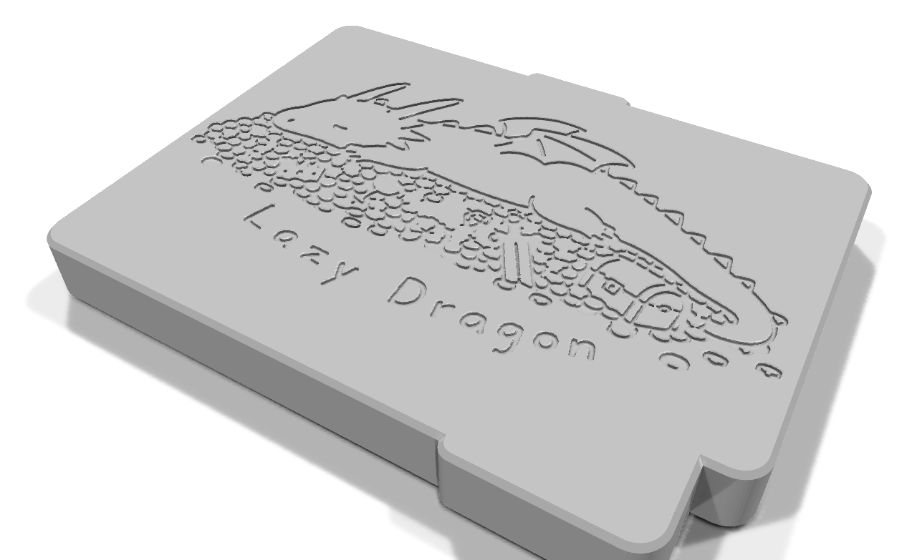
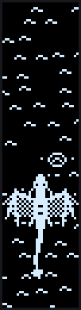

# Lazy Dragon 64

A 64-key reversible split keyboard with column stagger, hot-swap MX sockets and per-key RGB. Each half has an RP2040-Zero and a 0.91" OLED with its own animated dragon. Each sits in a 3D-printed case with an ivy-wrapped wall and a dragon engraved underneath, and has a matching lid.

<!-- Photos of the finished keyboard: replace images/photo-1.jpg, photo-2.jpg and photo-3.jpg (any size; keep the names or edit the links below). -->
| | | |
|:---:|:---:|:---:|
|  |  |  |


## Features

- **32 keys per half** (64 total): column-staggered, with a 1.5U thumb key
- **One reversible PCB** for both halves
- **Hot-swap MX sockets** (Kailh-style CPG151101S11)
- **Per-key RGB**: SK6812MINI-E reverse-mount LEDs that shine up through the PCB. The default effect is Dungeon Breath: a dim olive glow that swells to amber in a slow wave across both halves.
- **RP2040-Zero** controller on low-profile machined sockets
- **0.91" 128×32 I2C OLED** on each half (J2), with animations:
  - left half: the dragon asleep on its hoard, waking as you type
  - right half: the dragon flying over a scrolling map
- **USB-C split link** (J1): the halves are joined with a USB-C cable
- **QMK firmware** tuned for latency: 1 ms polling, eager debounce, and a 1 Mbaud full-duplex split link. The OLEDs are drawn from their own thread.
- **4-layer, 1.6 mm board** with 1 oz copper on every layer
- **Corne-style mounting**: an FR4 plate on M2 spacers that pass through the PCB
- **Generated cases** with an ivy or moon-phase band, an engraved dragon underneath, and a lid for carrying

## Gallery

The renders come from KiCad (`images/make_renders.py`) and don't include switches or keycaps.

### PCB

| | |
|:---:|:---:|
|  |  |
| Switch face (left-half build): RP2040-Zero, split-link USB-C, OLED header | Underside: hot-swap sockets, LEDs, diodes and capacitors |



### Switch plates

| | |
|:---:|:---:|
|  |  |
| `Lucca58 Stagger Plate`, 1.6 mm FR4 | `marikaplate`, the alternative plate |

### Cases

| | |
|:---:|:---:|
|  |  |
| Left half: Ivy Curl vine, "Lazy Dragon" on the front, chamfered top edge | Right half: the vine all the way round |
|  |  |
| Underside: the Lazy Dragon drawing engraved 0.6 mm | Marika case: a moon-phase band instead of the vine |

### Lid

| | |
|:---:|:---:|
|  |  |
| The lid, with the dragon engraved on top | On the case: it sits flush on the rim and closes over the keys |

### OLED screens

| Left half: the hoard | Right half: the flight |
|:---:|:---:|
|  |  |
| Asleep (z's), typing (the bars jump and the tail flicks), typing fast (eyes open, wing flapping), Caps Lock (fire, CAPS lit), then the FN layer | Flapping and gliding over sea, fields, a village, a castle, a river and forest, breathing fire now and then |

These run the real firmware drawing code on a PC (`firmware/dragon_screen/hoard_preview.c` and `flight_preview.c`).

## Building

Step-by-step instructions are in [BUILD.md](BUILD.md). The sections below are a quick reference.

### Which side gets what

Both halves use the same PCB. The RP2040-Zero (U1), the split-link USB-C (J1) and the OLED header (J2) go on one face, and every other part goes on the other.

| | U1, J1, J2 | Sockets, LEDs, diodes, caps | Bridge these jumpers |
|---|---|---|---|
| **Left half** | top (F) | bottom (B) | JP1, JP2, JP8, JP10, JP12, JP14 (B side) |
| **Right half** | bottom (B) | top (F) | JP4, JP5, JP7, JP9, JP11, JP13 (F side) |

C1 has a footprint on each face, so fit only one per half.

J1 is the link between the halves, not a USB port for the computer. Plug the computer into the RP2040-Zero's own USB-C.

### Bill of materials (one keyboard)

| Qty | Part | Notes |
|---:|---|---|
| 64 | MX hot-swap socket | CPG151101S11 |
| 64 | SK6812MINI-E | reverse-mount RGB LED |
| 64 | 1N4148W, SOD-123 | matrix diodes |
| 64 | 100 nF 0805 X7R | one per LED |
| 2 | 1 µF 0805 X7R | C1 |
| 2 | USB-C 16-pin receptacle | J1, HRO TYPE-C-31-M-12 footprint |
| 2 | RP2040-Zero | |
| 2 | 0.91" 128×32 SSD1306 I2C OLED | 4-pin GND/VCC/SCL/SDA |
| 2 × (9+9+5) | 2.54 mm machined female sockets | RP2040-Zero |
| 2 × 4 | 2.54 mm machined female sockets | OLED |
| ~54 | 2.54 mm male pins | RP2040-Zero and OLED |
| 64 | MX switches, keycaps | 62 × 1U, 2 × 1.5U |
| 1 | USB-C to USB-C cable | split link |

[`lcsc_cart.csv`](lcsc_cart.csv) is an LCSC cart export with the electronic parts, sized for about three keyboards. It lists two header options. The RP2040-Zero, switches and keycaps are not in it.

### Case and plate

Hardware per half, Corne v4 style:

- **Plate:** 1.6 mm FR4 switch plate (Gerbers in [`plate/production/`](plate/production)).
- **Standoffs:** 4 × M2 × 8 mm female–female (LCSC C50378452). Round ones up to Ø4.0, or 3.5 mm hex.
- **Screws:** 8 × M2 × 4 mm pan head (LCSC C357393), the same screw at both ends of each standoff. Any M2 head up to 3.5 mm wide and 1.3 mm tall fits.

The standoffs screw to the case floor and sit in pockets that set the plate at its designed height. They pass through the Ø5 holes in the PCB, and the plate screws onto them. The PCB hangs from the switches. Use 8 mm standoffs, not 7.5 mm: shorter ones put the hot-swap sockets on the case floor. [`case-final/README.md`](case-final/README.md#mounting-hardware-corne-v4-style) has the details.

The finished cases (print bottom-down):

| Folder | Description |
|---|---|
| [`case-final/`](case-final) | Ivy Curl vine wrap, "Lazy Dragon" on the front wall, dragon engraved underneath |
| `case-final/chamfer/` | the same with a 1 mm chamfer on the top outer edge, plus an X1C print project |
| `case-final/chamfer-no-dragon/` | chamfered, with a plain underside, plus an X1C print project |
| `case-final/cover/` | a lid for each half that sits on the rim and covers the keys, with the dragon engraved on top, plus an X1C print project for both lids |
| [`marika cases/`](marika%20cases) | moon-phase band instead of the vine, with its own `chamfer/` versions |

[`case-new-outline/`](case-new-outline) holds the generator and the earlier variants:

| Variant | Description |
|---|---|
| plain | no decoration |
| Ivy, Ivy Minimalist, Ivy Curl | a vine wrapped around the outer wall |
| Ivy Curl Deco | adds an Art Deco fan pattern on the rim |
| Right Ivy Curl Only | vine only, without the "Lazy Dragon" text |

### Firmware

QMK, in [`firmware/`](firmware). Flash `lazydragon64_left.uf2` to the left half and `lazydragon64_right.uf2` to the right. The reversible board mirrors the RP2040-Zero, so the matrix and the OLED's I2C pins are on different GPIOs on each half, and each half has its own build. [`firmware/README.md`](firmware/README.md) covers:
- **Flashing:** BOOT, or hold the top outer key while plugging in; double-tap RESET to get the `RPI-RP2` drive.
- **Layout:** BASE and FN. FN has the F-keys, arrows, media keys and the RGB controls.
- **Screens:** what each animation shows, how to change the pixel art, and how to preview it on a PC.
- **Lighting:** Dungeon Breath. FN + Brght−/+ sets the brightness and FN + Effect−/+ steps through QMK's other effects.
- **Latency settings:** 1 ms USB polling, eager per-key debounce, a fast matrix scan and the 1 Mbaud split link.

## Repository layout

| Path | Contents |
|---|---|
| `BUILD.md` | step-by-step build guide |
| `lazydragon64.kicad_*` | schematic and PCB (KiCad 10) |
| `production/` | PCB fabrication files |
| `lcsc_cart.csv` | LCSC parts cart |
| `images/` | the images in this README, and `make_renders.py`, which renders them with `kicad-cli` |
| `firmware/` | QMK firmware: `.uf2` files for each half, the keyboard source, and the OLED art and previews in `dragon_screen/` |
| `plate/` | `Lucca58 Stagger Plate` FR4 switch plate, `marikaplate` alternative plate, and their Gerber zips in `production/` |
| `case-final/` | the finished cases (STEP/STL), chamfered and plain-underside versions, the lids in `cover/`, and X1C print projects |
| `marika cases/` | the moon-phase cases |
| `case-new-outline/` | case and lid generator scripts, art data, and STEP/STL files for the earlier case variants |
| `case-new-outline/3d models/` | PCB, plate and spacer STEPs, plus the assembled left half |

The case scripts run under FreeCAD:

```
freecadcmd -c "exec(open('build_case.py').read())"
```

`build_case.py` reshapes the original Lucca58 case STEP, which isn't in this repo; point `CASE_SRC` at it. Its header lists the options, which are set as `CASE_*` environment variables. `build_cover.py` builds the lids from the cases, and `build_assembly.py` stacks the case, PCB, plate and spacers into one STEP.

## History

Lazy Dragon 64 grew out of the Lucca58 (the non-hall-effect version) and its stagger revision. Some plate and case file names still carry the Lucca58 name.
