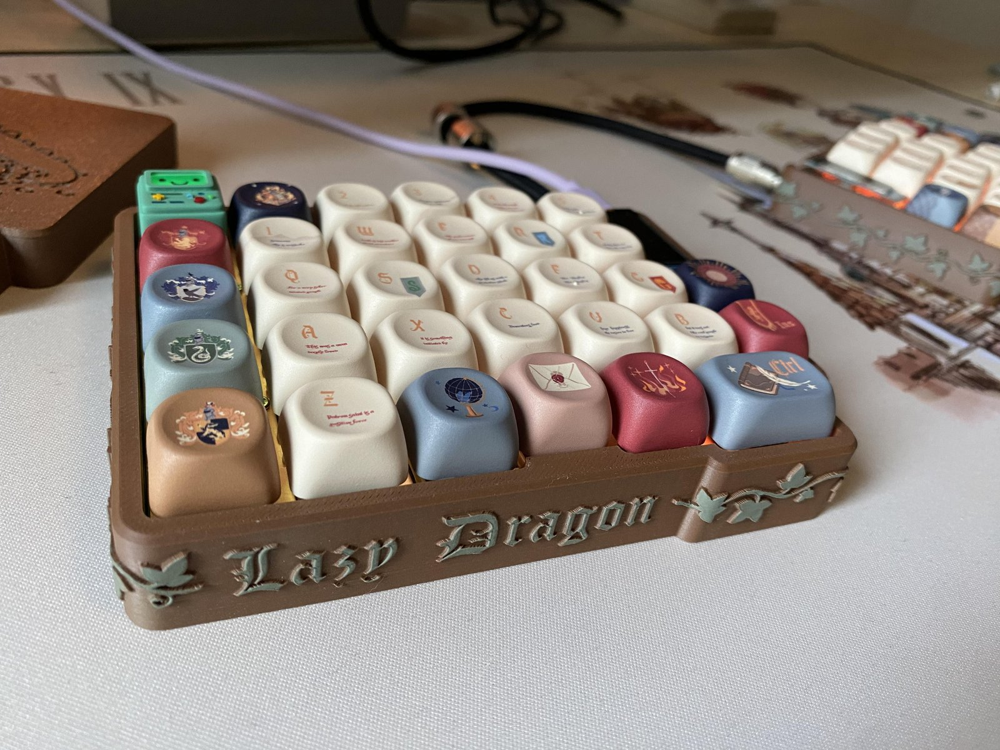
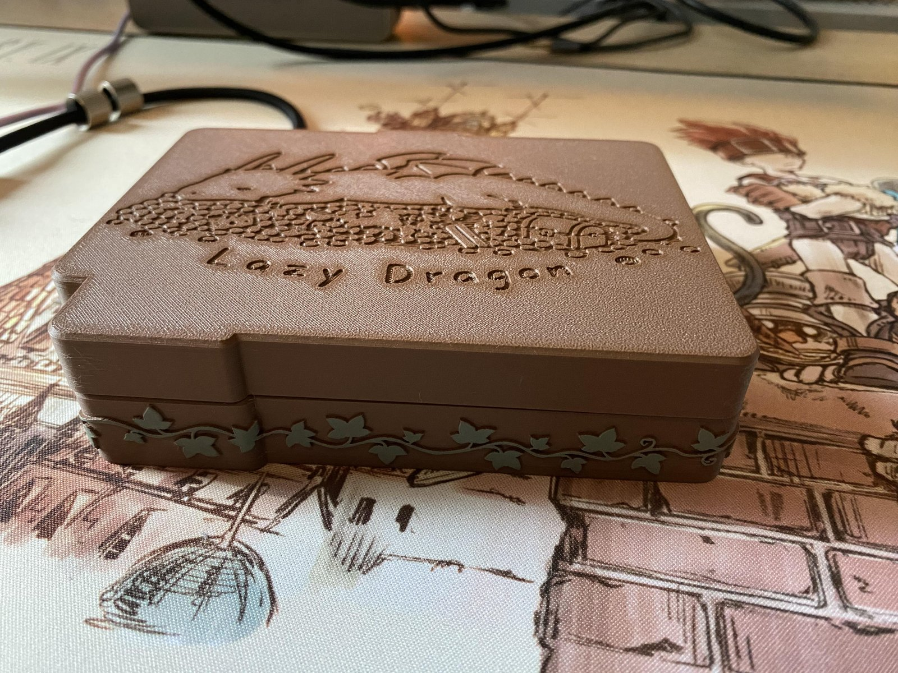
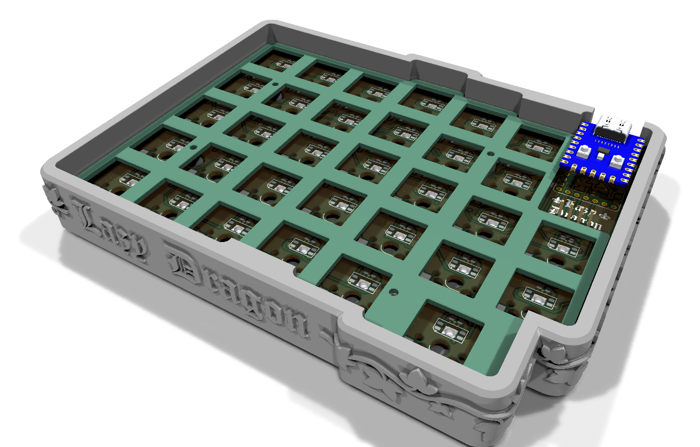
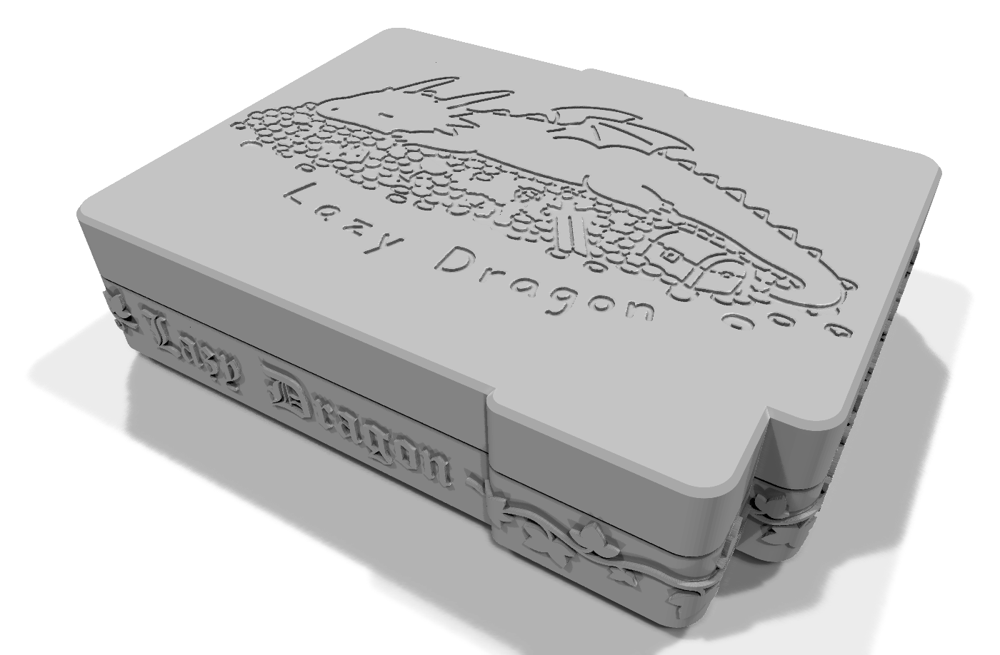
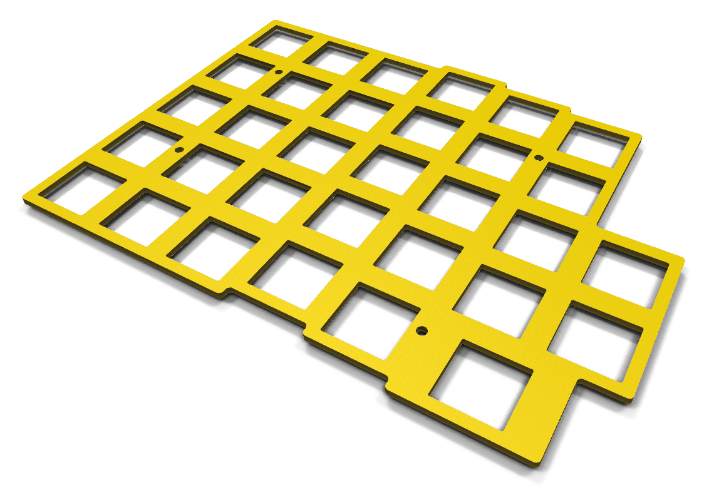
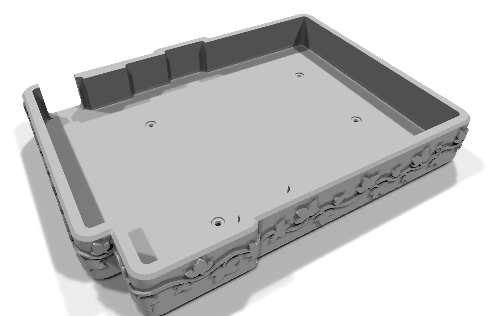

# Lazy Dragon 64

  

 
 
 
 
 

 

## Features

- 32 keys per half (64 total), column-staggered, with a 1.5U thumb key
- One reversible PCB for both halves
- Hot-swap MX sockets
- Per-key RGB
- RP2040-Zero controller
- 0.91" 128 × 32 OLED
- USB-C split link
- QMK firmware
- 4-layer, 1.6 mm PCB
- Corne-style mounting

## BOM

| Qty | Part |
|---:|---|
| 2 | PCB (`production/`) |
| 2 | 1.6 mm FR4 plate (`plate/production/`) |
| 2 | Case (`case-final/`) |
| 2 | RP2040-Zero |
| 2 | 0.91" 128 × 32 I2C OLED |
| 64 | MX hot-swap socket, CPG151101S11 |
| 64 | SK6812MINI-E |
| 64 | 1N4148W, SOD-123 |
| 64 | 100 nF 0805 |
| 2 | 1 µF 0805 |
| 2 | USB-C receptacle, 16-pin |
| 54 | 2.54 mm machined female socket |
| 54 | 2.54 mm male pin |
| 8 | M2 × 8 mm standoff |
| 16 | M2 × 4 mm screw |
| 64 | MX switch and keycap (62 × 1U, 2 × 1.5U) |
| 1 | USB-C cable |

## Install

| | RP2040-Zero, J1, J2 | Other parts | Bridge |
|---|---|---|---|
| Left | F | B | JP1, JP2, JP8, JP10, JP12, JP14 |
| Right | B | F | JP4, JP5, JP7, JP9, JP11, JP13 |

1. Bridge the jumpers. Solder the diodes, capacitors, LEDs (angled corner on the square pad) and hot-swap sockets. Fit C1 on one face only.
2. Solder J1, the RP2040-Zero's sockets and J2.
3. Hold BOOT and plug the RP2040-Zero in. Copy `firmware/lazydragon64_left.uf2` or `lazydragon64_right.uf2` to the `RPI-RP2` drive.
4. Plug in the RP2040-Zero and the OLED.
5. Screw the standoffs to the case floor. Clip the switches into the plate, press the PCB onto them, set it in the case and screw the plate on.
6. Join the halves with a USB-C cable between the J1 ports. Plug the computer into either RP2040-Zero.
